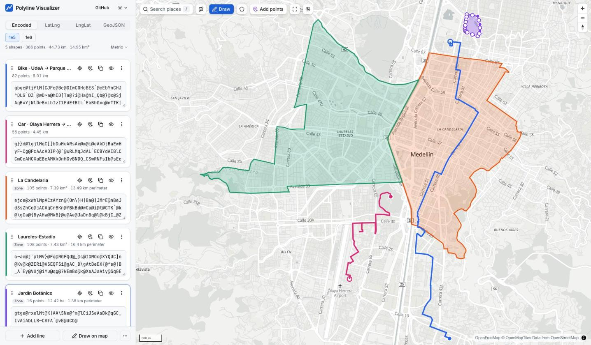

# Polyline Visualizer

Decode, encode, draw and edit polylines on a map. Every line is shown in one
format at a time and stays in sync with the map.

## [polyline-visualizer.vercel.app](https://polyline-visualizer.vercel.app/)

<a href="https://polyline-visualizer.vercel.app/#l=gbge%40tjflM%7CCJFe%40Be%40GIwCOHcBES%60%40cEbYnCHJ%5EDLG%60DZ%60%40wD%7Ea%40hED%5BTa%40%3Fi%40Ha%40hI_Qb%40%7D%40x%40SjAqBvYjNlDrBnLbIzIlFdEfBtL%60EkBbGxq%40nTTK%7C%40%40n%40NVABa%40HEdABZUfA%5EJY%5CJ%40Tv%40Ov%40TdAD%40YJI%3Fk%40Ne%40dB%7BCd%40SXHxChBTV%3FLqBlCJRlQt%40fDBp%40uMlBiEPOVCpDN%40Eb%5BzA%3FQ%60N%40%7C%40P%5CR%60ChB%7EBpAfHhBvBqIfBy%40dGzArFgStCx%40t%40kCZi%40&l=g%7D%7Dd%40lgjlMqC%5B%5DbDuMuARsAe%40m%40i%40eAkDjBaEwHyF%7ECg%40PcAAcAOIP%7B%40%60%40wRLMqJdAL%60ECBYdAIBlCCmCeAHCXaEBeAMKkOnHGvBNDQ_CSwRNFsIb%40sEeADa%40Rs%40vB_CbCa%40z%40e%40j%40_%40LwALuADiCq%40cB%3F_%40We%40cAIgA_%40%7DAFe%40Z_%40ZeAhAC%5EI&l=ejce%40xwhlMpACzAYzn%40%7BOn%5C%7DH%7CBa%40%7CJMrE%40nBeJdSsZhCe%40jACAqCrBKn%40YBkBd%40wCp%40i%40t%40CTK%60%40k%40%5CgCa%40%7BByAHw%40MkB%7D%40u%40Ae%40JaDnBq%40l%40kBjC_%40ZkAXsF_%40sAk%40aAs%40oAg%40%7B%40E%7B%40ViFjCcAl%40sApAyBuC_AiCR%7DAVILOZkA%7DD_DmBW_A%5BcDkBKWi%40Sy%40GeBa%40_B%3FyAT_AVeGbD%7D%40z%40_FwDiCcFIw%40HiANs%40z%40mAJc%40Cu%40Se%40y%40i%40aGqIiDuATk%40aIuImIsFaCiADMoFoAc%40pDi%40GkA%5Cw%40MSD_%40b%40sAKuAa%40aPbW_HfLk%60%40_U%7D%40WNcDcDtD%5DnEsCeBw%40%60IIhBmA%60Lm%40hKDv%40sFxp%40rNrC%7CLdEneAfe%40fBj%40&l=o%7Eae%40j%60plMV%7D%40Fq%40RGFQd%40_%40s%40IGMOc%40XYQUC%5Dn%40Kv%40k%40ZERi%40VSEQFSi%40gAC_D%5CgAtBeDX%7B%40%5Ee%40%7CB_A%60Ey%40VUj%40iYu%40qg%40%3FkEmBd%40k%40XeAJaAiy%40SqGEgLiAm%7D%40%7Bn%40zO%7BAXqAB%7DAOgBk%40%7BaAkc%40dApDdBrIPjCHbH%5DlDqBvJCd%40%5D%7E%40mD%7CEu%40tAiAlDy%40p%40%7BCj%40_Ax%40g%40xAmAz%40_BNyBt%40y%40dA%7D%40VaLzS%7BHpGeCzCcA%60%40sAhA%5Dp%40m%40%5CqBTwCfCdDdDf%40Rz_BvTdAVlBt%40yA%7DFi%40yFj%5DxACtGLbECrAQ%7CAy%40lCW%60Hdm%40bBm%40xCsCnS%7EBnBnAZpFx%40e%40nIOzAUbAo%40%60ICjErC%60C%40Ln%40ZOx%40F%7C%40A%60DLf%40GdAh%40vAb%40vB&l=gtge%40rxelMt%40K%7CAA%5CSNe%40%5Em%40lCiJSeAsDk%40qGC_IvAiAbLLR%7ECAfA%60%40vB%40&n=Bike+%C2%B7+UdeA+%E2%86%92+Parque+Lleras&n=Car+%C2%B7+Olaya+Herrera+%E2%86%92+Pueblito+Paisa&n=La+Candelaria&n=Laureles-Estadio&n=Jard%C3%ADn+Bot%C3%A1nico&z=2%2C3%2C4">
  <picture>
    <source media="(prefers-color-scheme: dark)" srcset="docs/screenshot-dark.jpg" />
    
  </picture>
</a>

<sub>Medellín: routes snapped to roads with Valhalla, comuna outlines from OpenStreetMap. Click the image to open this example.</sub>

- Formats: encoded polyline (precision 5 or 6), LatLng array, LngLat array
  and GeoJSON. Switching format re-renders every line.
- Paste detection: pasted text in another format or precision is recognised
  and the app switches to it (e.g. an OSRM/Valhalla precision-6 string, a
  LngLat array whose longitudes exceed ±90, a GeoJSON Feature).
- Several lines, each with a name, colour, stats (points, length), copy,
  zoom-to, show/hide and delete. Several polylines pasted at once
  (whitespace-separated, nested arrays, MultiLineString, FeatureCollection)
  become separate lines.
- Draw new lines on the map, drag vertices, drag a midpoint to insert a
  vertex, right-click a vertex to delete it. Start/end markers.
- Zones (closed shapes): draw them, toggle any line closed, or paste a ring
  (first point repeated at the end), a GeoJSON Polygon/MultiPolygon or a KML
  polygon. Filled on the map with area and perimeter; written back with the
  closing point (Polygon in GeoJSON). Holes are not supported. Areas show in
  m², ha or km² automatically, or always in one unit.
- Units: metric (m, km) or imperial/US (ft, mi; ft², acres, mi²), for every
  distance, area, the simplify tolerance and the map's scale bar. Lengths
  and perimeters, and zone areas, can each be fixed to one unit. US English
  browsers start in imperial; the choice is remembered per browser.
- Simplify (Douglas–Peucker) with a tolerance slider in metres and a dashed
  preview before applying.
- Points and segments: every point with segment length, running total and
  bearing; edit or delete coordinates, hover to ring a point on the map.
  Download the table as CSV or TSV (metres and degrees).
- Import GPX, KML, GeoJSON, CSV/TSV (lat/lng columns, optional line and
  zone columns; comma, tab or semicolon) or text by dropping files anywhere
  (or from the menu); download one line or all as GeoJSON, GPX, KML, or a CSV/TSV of points
  (line, point, lat, lng, segment, running total, bearing, zone).
- Reorder lines by dragging the grip, with Move up/down in the card menu, or
  Alt+↑/↓ (keyboard drag: Space, arrows, Space).
- Add points to an existing line: “Add points” (on the map or a card), then
  click the map to extend it from its end or start; ⌫ undoes, Enter or Esc
  finishes. Also works to draw into an empty line.
- Clear errors (out-of-range coordinates, truncated polylines, wrong order or
  precision). Invalid text never moves the map; Esc restores the last valid
  value.
- Shareable URL: lines, names, format and precision live in the hash
  (`#f=latlng&pr=6&l=…&n=…`), so long polylines never hit request limits.
  Copy all lines in any format, or as a FeatureCollection.
- Place search (press `/`): search-as-you-type with
  [Photon](https://photon.komoot.io) over OpenStreetMap, biased to the map
  view; the map flies to the result and drops a marker.
- Shapes from OpenStreetMap: **Shape** on a search result imports its
  outline or line (Nominatim lookup, simplified for big areas); the route
  button finds bus, metro, tram, train, bike and hiking routes, streets and
  rivers in the map view (Overpass, several public mirrors) and stitches
  their ways into lines.
- Snap to roads: re-route a line through its points by car, bike or on foot
  (Valhalla on FOSSGIS servers; up to 46 waypoints in batches of 10), with
  undo.
- Light, dark and system themes; the basemap follows. Satellite view (Esri
  World Imagery with roads and places), remembered per browser.

Originally a fork of [open-polyline-decoder](https://open-polyline-decoder.60devs.com/).

## Development

```sh
bun install
bun dev          # dev server with HMR on http://localhost:3000
bun test         # encoding, formats, store and URL tests
bun run typecheck
bun run build    # static site in dist/
bun run preview  # build, then serve dist/ (PORT=4419 to change the port)
```

Built with Bun, React, [MapLibre GL](https://maplibre.org/) with
[OpenFreeMap](https://openfreemap.org/) tiles (free, no API key), Esri World
Imagery for the satellite view,
[Terra Draw](https://terradraw.io/) and shadcn/ui on Base UI. Hosted on
Vercel.

## Deploying

Static build on Vercel (`vercel.json`): Bun is detected from `bun.lock`,
`bunVersion` pins it, and `dist/` is served as static files. The dev server's
`Bun.serve()` HTML imports are not used in production. MapLibre's worker is
copied to `dist/vendor/` (versioned) and fonts to `dist/fonts/` by `build.ts`.
